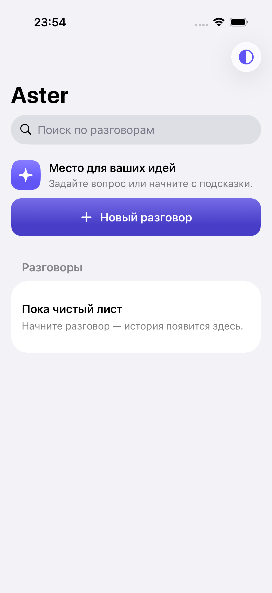
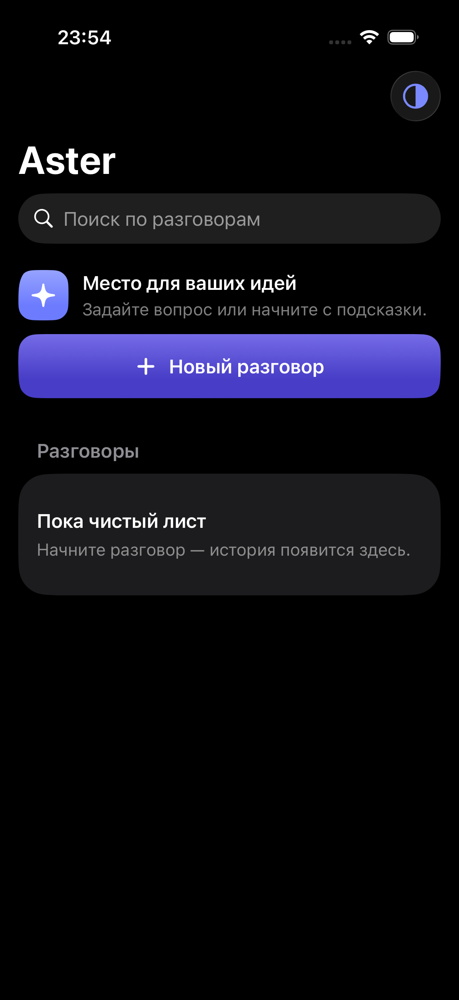
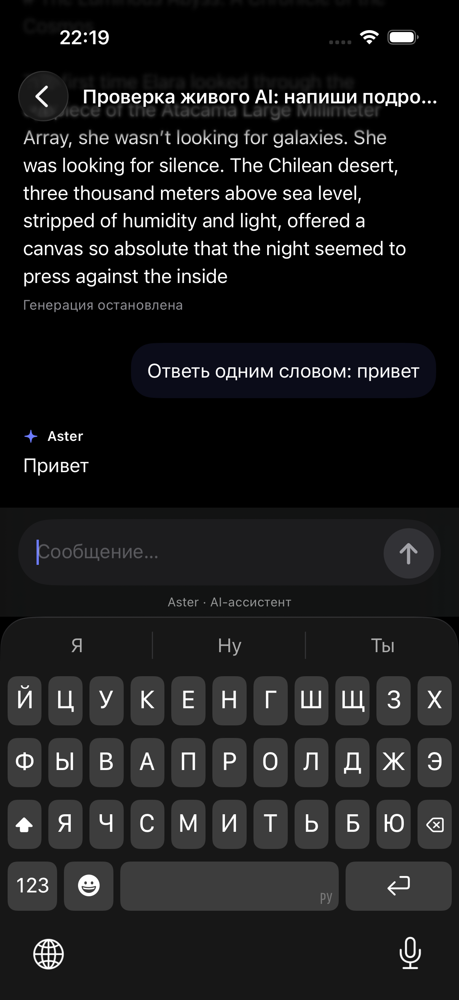

<div align="center">
  
  <h1>Aster · AI Assistant</h1>
  <p><strong>Нативный AI-чат для iPhone — для вопросов, текстов и новых идей.</strong></p>
  <p>Ответы в реальном времени · История разговоров · Светлая и тёмная тема</p>
  <p>
    
    
    
    
    
  </p>
  <p>
    <a href="#что-это">О приложении</a> ·
    <a href="#интерфейс">Скриншоты</a> ·
    <a href="#быстрый-запуск">Запуск</a> ·
    <a href="#архитектура">Архитектура</a>
  </p>
</div>

## Что это

**Aster** — приложение для общения с AI на iPhone. Можно попросить объяснить сложную тему, помочь с текстом или придумать идею. Ответ появляется постепенно, а историю разговоров можно открыть снова после перезапуска приложения.

Приложение написано на **SwiftUI**, хранит диалоги локально через **SwiftData** и получает ответы через **OpenRouter**. В репозитории — исходный код, проект XcodeGen, тесты и скриншоты. Для запуска нужен собственный API-ключ.

## Интерфейс

<table>
  <tr>
    <th>Светлая тема</th>
    <th>Тёмная тема</th>
    <th>Разговор с AI</th>
  </tr>
  <tr>
    <td align="center"></td>
    <td align="center"></td>
    <td align="center"></td>
  </tr>
</table>

Скриншоты из симулятора, сделанные во время разработки. Больше примеров — в [docs/screenshots](docs/screenshots).

## Возможности

| Возможность | Как это работает |
| --- | --- |
| **Потоковые ответы** | Текст появляется по мере получения данных от AI через Server-Sent Events. |
| **Остановка и повтор** | Можно остановить генерацию, сохранить полученную часть ответа и продолжить разговор. Повтор после ошибки не дублирует вопрос. |
| **Несколько разговоров** | Создание, переключение и удаление с подтверждением. Название формируется из первого вопроса. |
| **История и поиск** | Разговоры сохраняются на устройстве. Поиск работает по названиям и содержимому сообщений. |
| **Копирование и отправка** | Ответ можно скопировать или отправить через системное меню «Поделиться». |
| **Настройка оформления** | Системная, светлая и тёмная тема; выбор сохраняется между запусками. |
| **Удобство чтения** | Dynamic Type, поддержка длинных сообщений, управление прокруткой и кнопка возврата к последнему сообщению. |
| **Обработка ошибок** | Понятные сообщения при отсутствии сети, таймауте, исчерпании квоты и обрыве ответа. |

## Быстрый запуск

### 1. Подготовьте инструменты

Нужен **Mac с Xcode**, iOS SDK, Swift 6, установленный iPhone Simulator и **XcodeGen**. Для настройки ключа используется системный Python 3.

Установите XcodeGen через Homebrew, если он ещё не установлен:

```bash
brew install xcodegen
```

В Xcode проверьте **Settings → Locations → Command Line Tools** и наличие симулятора в **Settings → Components**.

### 2. Скачайте проект

```bash
git clone https://github.com/lu1mer/AI-Assistant.git
cd AI-Assistant
```

### 3. Добавьте API-ключ

Создайте свой ключ в [OpenRouter](https://openrouter.ai/settings/keys), затем выполните:

```bash
./ConfigureAI.command
```

Ввод ключа скрыт. Скрипт генерирует локальные значения в `Sources/Services/AI/EmbeddedCredential.swift`; в репозитории они пустые.

> **Не публикуйте сгенерированный файл с ключом.** XOR-обфускация позволяет извлечь ключ из исходников или собранного приложения. Для приложения, распространяемого среди пользователей, понадобится отдельная схема хранения и доступа к API-ключам.

### 4. Соберите и запустите

```bash
./Build.command
open AIAssistant.xcodeproj
```

В Xcode выберите схему **AIAssistant**, iPhone Simulator и нажмите **Run**. Можно также запустить `ConfigureAI.command` и `Build.command` двойным кликом в Finder.

Сборка для симулятора не требует настройки подписи. Для физического iPhone укажите свою Apple development team в **Signing & Capabilities**.

<details>
<summary>Если настройка ключа сообщает Operation not permitted</summary>

Разрешите Terminal доступ к «Документам»: **Системные настройки → Конфиденциальность и безопасность → Файлы и папки → Terminal → Документы**. Полностью перезапустите Terminal и повторите запуск скрипта.

</details>

## Как устроен AI

Клиент отправляет историю текущего разговора в OpenRouter и читает поток ответа через `URLSession.AsyncBytes`. SSE-декодер превращает события в фрагменты текста, которые отображаются в чате.

В коде используется маршрутизатор **`openrouter/free`**. Конкретную модель выбирает провайдер; доступность и квоты зависят от сервиса и аккаунта. В запросе установлен предел ответа в 2048 токенов. Платная запасная модель в приложении не настроена.

История хранится локально, а при запросе сообщения разговора передаются OpenRouter для генерации ответа. Синхронизация через iCloud не реализована.

## Архитектура

**MVVM + сервисный слой**, Swift 6 concurrency и только Apple frameworks в приложении. Сторонних зависимостей приложения нет; XcodeGen используется для генерации проекта.

```text
Sources/
├── App/                    Точка входа и сборка зависимостей
├── Features/
│   ├── Chat/               Экран чата, сообщения и ViewModel
│   └── ChatList/           Список разговоров и поиск
├── Models/                 Модели разговоров и сообщений
├── Services/
│   ├── AI/                 OpenRouter, SSE-декодер и ошибки
│   └── Persistence/        SwiftData и репозиторий разговоров
├── Core/UI/                Цвета, тема и оформление
└── Resources/              Иконка приложения
```

| Слой | Ответственность |
| --- | --- |
| **SwiftUI Views** | Отображение состояния и действия пользователя. |
| **ChatViewModel** | Запросы, потоковый ответ, отмена и повтор. |
| **AIService** | Подменяемый интерфейс AI-клиента; реальная реализация работает с OpenRouter. |
| **ConversationRepository** | Сохранение и восстановление разговоров через SwiftData. |

UI и работа с `ModelContext` изолированы на `MainActor`. При остановке, уходе с экрана или сворачивании приложения генерация отменяется, а полученный текст сохраняется.

## Тесты

```bash
./Test.command
```

Скрипт генерирует Xcode-проект и запускает unit- и UI-тесты на доступном iPhone Simulator. Обычные тесты используют детерминированные фикстуры и не расходуют API-квоту.

Проверяются SSE-декодирование, сетевые ошибки, отмена, повтор запросов, сохранение истории и основные сценарии интерфейса. Схема **LiveAI** предназначена для отдельной проверки реального API: ей нужен настроенный ключ, и она расходует квоту.

В отчёте исходной разработки от **5–6 октября 2026 года** зафиксированы успешные Debug/Release-сборки, **20 unit-тестов**, **7 UI-тестов** и отдельный сценарий с реальным OpenRouter API. Это исторические результаты; при оформлении README тесты приложения заново не запускались. Подробности — в [docs/testing.md](docs/testing.md).

## Ограничения

- Deployment target — **iOS 18.0**, 
- Для генерации требуется интернет; offline AI, работа с фото и версия для Mac не реализованы.
- Ответы отображаются обычным текстом, без расширенного Markdown и подсветки кода.
- Генерация прекращается при уходе из чата или сворачивании приложения.
- При внезапном завершении процесса могут потеряться последние фрагменты ответа между сохранениями (до 350 мс).

## Документация разработки

- [План и принятые решения](docs/plan.md)
- [Проверки и результаты тестов](docs/testing.md)
- [Финальный аудит](docs/final-audit.md)
- [Ревью кода](docs/review.md)
- [Очищенные логи разработки](ai-logs/README.md)

<details>
<summary>Инструменты и история проекта</summary>

Исходный проект разрабатывался с использованием Codex, Xcode 26.3, Swift 6 и XcodeGen 2.46.0. В исходных логах указаны модели `gpt-6-astra` и `gpt-6.1-sol`. Оценка активного времени Codex — около **1,55 часа**; метод расчёта сохранён в [docs/time.json](docs/time.json).

GitHub-версия импортирована с новым начальным коммитом. Встроенный ключ и Git-история из первоначального архива не перенесены. Отчёты в `docs/` описывают этапы исходной разработки; некоторые ранние записи относятся к интеграции Groq до перехода на OpenRouter.

</details>
